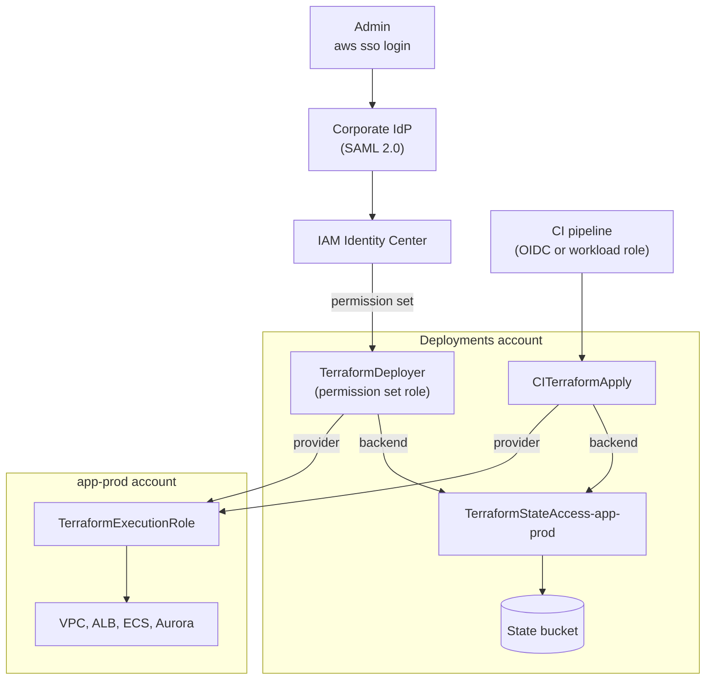

In an AWS org with many accounts, it's common for Terraform to run with different credentials depending on who runs it: an admin SSO profile, an old IAM access key, a CI role created by hand. That makes it hard to know who changed what, and whether they should have been able to.

This post shows a standard way to control Terraform deployment access that works the same from an admin's laptop and from CI. Every Terragrunt run assumes the same small set of roles, and the role ARNs come from the folder it runs in. The backend and the provider both use `assume_role`, so the credentials you start with can't make changes in a workload account directly.

The example repo is at [github.com/cmsheehan/infrastructure-live](https://github.com/cmsheehan/infrastructure-live). It shows patterns, not a ready-to-use baseline. The account IDs are placeholders, and the role names and permissions show the structure. Make your roles as narrow as your org allows. The last section covers where I'd tighten things further.

> **Note:** The Terraform and Terragrunt code in this post and in the example repo was AI-generated to illustrate the patterns. It hasn't been run against real AWS accounts, so don't assume it's valid or complete. Check module inputs, IAM policies and versions against the official docs before you use any of it.

## The accounts

The accounts follow AWS's [multi-account whitepaper](https://docs.aws.amazon.com/whitepapers/latest/organizing-your-aws-environment/organizing-your-aws-environment.html), with the names it uses:

| Account            | OU             | Purpose                                                  |
| ------------------ | -------------- | -------------------------------------------------------- |
| Management         | Root           | Organizations, Control Tower, billing. Not in this repo. |
| `log-archive`      | Security       | Central log buckets                                      |
| `security-tooling` | Security       | Delegated admin for GuardDuty and Security Hub           |
| `network`          | Infrastructure | Transit Gateway                                          |
| `shared-services`  | Infrastructure | ECR and other shared tooling                             |
| `deployments`      | Deployments    | CI/CD identities and Terraform state                     |
| `app-prod`         | Workloads      | Production                                               |
| `app-nonprod`      | Workloads      | Dev and staging                                          |

The Deployments account is the important one here. Every Terraform run in the org starts there.

The management account isn't in the repo. No pipeline should have a role in it, so changes there are made by hand.

## The repo

The layout is Gruntwork's [infrastructure-live](https://docs.gruntwork.io/2.0/docs/overview/concepts/infrastructure-live/) hierarchy of account, region, environment, category and unit, all under `live/`:

```text
live/
├── root.hcl
├── _envcommon/                    # shared config for each unit of the app
│   ├── networking/vpc.hcl
│   ├── web/acm.hcl
│   ├── web/alb.hcl
│   ├── app/ecs-cluster.hcl
│   ├── app/ecs-service.hcl
│   └── data/aurora-postgresql.hcl
├── app-prod/
│   ├── account.hcl
│   ├── env.hcl                    # no environment directory
│   ├── _global/
│   │   └── dns/route53-zone/
│   └── us-east-1/
│       ├── region.hcl
│       ├── _global/
│       │   └── security/kms/
│       ├── networking/vpc/
│       ├── web/acm/
│       ├── web/alb/
│       ├── app/ecs-cluster/
│       ├── app/ecs-service/
│       └── data/aurora-postgresql/
├── app-nonprod/
│   ├── account.hcl
│   ├── _global/
│   │   └── dns/route53-zone/
│   └── us-east-1/
│       ├── region.hcl
│       ├── _global/
│       │   └── security/kms/
│       ├── dev/
│       │   ├── env.hcl
│       │   ├── networking/ web/ app/ data/
│       └── staging/
│           ├── env.hcl
│           └── networking/ web/ app/ data/
├── log-archive/ security-tooling/ network/ shared-services/ deployments/
```

The two workload accounts are laid out differently on purpose. `app-nonprod` holds dev and staging, so each environment has its own directory and `env.hcl`. `app-prod` only holds production, which the account name already says, so it skips the environment directory and keeps `env.hcl` at the account root next to `account.hcl`:

```hcl
# live/app-prod/env.hcl
locals {
  environment   = "prod"
  vpc_cidr      = "10.10.0.0/16"
  domain_name   = "app.example.com"
  app_image_tag = "1.4.2"
}
```

`root.hcl` finds it with `find_in_parent_folders("env.hcl")`, which searches upward from the unit, so it works at either depth.

Inside an environment, the categories match the tiers of a three-tier app:

- `networking/vpc`: public subnets for the load balancer, private subnets for the containers, and database subnets with no internet route.
- `web/`: the ACM certificate and the ALB.
- `app/`: an ECS cluster and a Fargate service.
- `data/`: Aurora PostgreSQL.

Security groups only allow traffic from the tier in front: the ALB accepts 443 from the internet, the service accepts 8080 only from the ALB, and Aurora accepts 5432 only from the service.

The shared config for each unit lives in `_envcommon/`. Each environment's unit file includes it and adds only what's different. For example, prod's database adds a second instance, longer backups and deletion protection:

```hcl
# live/app-prod/us-east-1/data/aurora-postgresql/terragrunt.hcl
include "root" {
  path = find_in_parent_folders("root.hcl")
}

include "envcommon" {
  path = "${dirname(find_in_parent_folders("root.hcl"))}/_envcommon/data/aurora-postgresql.hcl"
}

inputs = {
  instances               = { one = {}, two = {} }
  backup_retention_period = 35
  deletion_protection     = true
  skip_final_snapshot     = false
}
```

`_global` is used at two levels:

- `<account>/_global/` is for resources that aren't tied to a region, like the Route 53 zone. There's no `region.hcl` above it, so `root.hcl` falls back to `us-east-1`.
- `<account>/us-east-1/_global/` is for regional resources shared by every environment in the account, like the KMS key for the data tier.

In `app-nonprod`, `_global` units have no `env.hcl` above them, so they use `environment = "global"`. In `app-prod`, they use the account-level `env.hcl` and get `prod`.

Environment units read `_global` outputs through dependencies. The paths are built from the location of `account.hcl` or `region.hcl` instead of relative `../` paths, so the same `_envcommon` file works for prod and dev even though they sit at different depths:

```hcl
dependency "zone" {
  config_path = "${dirname(find_in_parent_folders("account.hcl"))}/_global/dns/route53-zone"
}

dependency "kms" {
  config_path = "${dirname(find_in_parent_folders("region.hcl"))}/_global/security/kms"
}
```

## Where the roles come from

Each `account.hcl` names the roles Terraform uses for that account:

```hcl
# live/app-prod/account.hcl
locals {
  account_name = "app-prod"
  account_id   = "666666666666"

  execution_role_arn = "arn:aws:iam::666666666666:role/TerraformExecutionRole"
  plan_role_arn      = "arn:aws:iam::666666666666:role/TerraformPlanRole"

  state_role_arn = "arn:aws:iam::555555555555:role/TerraformStateAccess-app-prod"

  dns_zone_name = "app.example.com"
}
```

- `TerraformExecutionRole` is in `app-prod` and makes changes there.
- `TerraformPlanRole` is in `app-prod` and is read-only.
- `TerraformStateAccess-app-prod` is in Deployments and can only read and write `app-prod`'s state files.

`root.hcl` reads that file and picks a provider role:

```hcl
locals {
  account = read_terragrunt_config(find_in_parent_folders("account.hcl")).locals
  region  = try(read_terragrunt_config(find_in_parent_folders("region.hcl")).locals, { aws_region = "us-east-1" })
  env     = try(read_terragrunt_config(find_in_parent_folders("env.hcl")).locals, { environment = "global" })

  plan_only         = get_env("TG_PLAN_ONLY", "false") == "true"
  provider_role_arn = local.plan_only ? local.account.plan_role_arn : local.account.execution_role_arn

  actor        = get_env("TG_ACTOR", get_env("USER", "unknown"))
  session_name = substr(replace("terragrunt-${local.actor}", "/[^\\w+=,.@-]/", "-"), 0, 64)
}
```

The session name comes from `TG_ACTOR` or `$USER` and makes CloudTrail easier to read. The caller sets it, so treat it as a label, not proof of who ran something.

Every unit includes `root.hcl`, and it's the only file in the repo that defines a backend or a provider. Here's the backend:

```hcl
remote_state {
  backend = "s3"
  generate = {
    path      = "backend.tf"
    if_exists = "overwrite_terragrunt"
  }
  config = {
    bucket       = "example-org-terraform-state-555555555555-us-east-1"
    key          = "infrastructure-live/${path_relative_to_include()}/terraform.tfstate"
    region       = "us-east-1"
    encrypt      = true
    kms_key_id   = "arn:aws:kms:us-east-1:555555555555:alias/terraform-state"
    use_lockfile = true

    assume_role = {
      role_arn     = local.account.state_role_arn
      session_name = local.session_name
    }

    disable_bucket_update = true
  }
}
```

All state is in one bucket in Deployments, and the key matches the unit's path. For example, `live/app-prod/us-east-1/data/aurora-postgresql` stores its state at `infrastructure-live/app-prod/us-east-1/data/aurora-postgresql/terraform.tfstate`.

Each account's state role only covers its own prefix, so a wrong path in `app-nonprod` can't affect production state. This protects against mistakes, not against someone with write access to the repo, who could change `account.hcl` to use a different role. The trust policies are the real boundary.

`use_lockfile` uses S3's native locking, so no DynamoDB table is needed. `disable_bucket_update` prevents Terragrunt from changing the bucket's settings.

And the provider:

```hcl
generate "provider" {
  path      = "provider.tf"
  if_exists = "overwrite_terragrunt"
  contents  = <<-EOF
    provider "aws" {
      region              = "${local.region.aws_region}"
      allowed_account_ids = ["${local.account.account_id}"]

      assume_role {
        role_arn     = "${local.provider_role_arn}"
        session_name = "${local.session_name}"
      }

      default_tags {
        tags = {
          Account     = "${local.account.account_name}"
          Environment = "${local.env.environment}"
          ManagedBy   = "terragrunt"
          Unit        = "${path_relative_to_include()}"
        }
      }
    }
  EOF
}
```

`allowed_account_ids` makes the provider stop if the role resolves to a different account, for example because of a typo in `account.hcl`.

The backend and provider use different roles on purpose. The role that changes production resources can't access the state bucket, and the role that writes state can't change resources.

## Why this is more secure

The starting credentials can't do anything in a workload account on their own. They can only assume specific roles, and the trust policies on those roles control who can use them.

- To see who can apply to production, read the trust policy on `TerraformExecutionRole` in `app-prod`.
- There are no long-lived access keys. People get short-lived credentials from IAM Identity Center, and CI gets them from its platform's federation or workload role.
- Admins and CI use the same roles with the same permissions.
- Restricting the execution role, or adding an SCP, applies to every run in the org.
- CloudTrail records each `AssumeRole` call and who made it. For Identity Center sessions, that includes the person's username.

## The auth flow



Arrows labeled provider or backend are `sts:AssumeRole` calls that Terragrunt makes.

Both paths start from a hub role in Deployments. Terragrunt then assumes the state role for the backend and the target account's role for the provider. The target account only trusts the hub roles.

## From a laptop: IAM Identity Center

The admin belongs to an IdP group (for example Okta or Entra ID) that Identity Center syncs over SCIM. That group is assigned the `TerraformDeployer` permission set in the Deployments account. Signing in gives them a role there named `AWSReservedSSO_TerraformDeployer_<random suffix>`. The permission set only allows assuming the Terraform roles:

```json
{
  "Version": "2012-10-17",
  "Statement": [
    {
      "Sid": "AssumeTerraformRoles",
      "Effect": "Allow",
      "Action": ["sts:AssumeRole", "sts:TagSession"],
      "Resource": [
        "arn:aws:iam::*:role/TerraformExecutionRole",
        "arn:aws:iam::*:role/TerraformPlanRole",
        "arn:aws:iam::555555555555:role/TerraformStateAccess-*"
      ],
      "Condition": {
        "StringEquals": { "aws:ResourceOrgID": "o-exampleorg" }
      }
    }
  ]
}
```

They need one AWS CLI profile:

```ini
# ~/.aws/config
[sso-session example-org]
sso_start_url = https://example-org.awsapps.com/start
sso_region = us-east-1
sso_registration_scopes = sso:account:access

[profile deployments-terraform]
sso_session = example-org
sso_account_id = 555555555555
sso_role_name = TerraformDeployer
region = us-east-1
```

```bash
aws sso login --profile deployments-terraform
export AWS_PROFILE=deployments-terraform

aws sts get-caller-identity   # AWSReservedSSO_TerraformDeployer_... in 555555555555

cd live/app-nonprod/us-east-1/dev
TG_PLAN_ONLY=true terragrunt run --all plan
terragrunt run --all apply
```

The profile doesn't name a target account. Terragrunt reads it from `account.hcl` and assumes the roles, so the same profile works anywhere in the repo.

Most engineers only need a `TerraformPlanner` permission set, which can assume the plan role and the state roles but not the execution role. That lets them plan changes without being able to apply them.

## From CI

CI needs a role in Deployments, `CITerraformApply` for applies and `CITerraformPlan` for plans, with the same `sts:AssumeRole` permissions as the matching permission set. Hosted CI usually gets into that role with OIDC. Self-hosted runners, or tools like Atlantis, can use their instance, task or pod role. After that, the job runs the same `terragrunt` commands shown above.

If you use OIDC, limit the trust policy to the exact repository and the protected branch or environment that's allowed to apply. A wildcard would let anyone who can push a branch use the role.

Atlantis usually plans and applies with one identity. To keep plan and apply separate, run it with two roles or two servers.

## The execution role trust policy

This is the trust policy on `TerraformExecutionRole` in a member account:

```json
{
  "Version": "2012-10-17",
  "Statement": [
    {
      "Effect": "Allow",
      "Principal": { "AWS": "arn:aws:iam::555555555555:root" },
      "Action": ["sts:AssumeRole", "sts:TagSession"],
      "Condition": {
        "ArnLike": {
          "aws:PrincipalArn": [
            "arn:aws:iam::555555555555:role/aws-reserved/sso.amazonaws.com/*AWSReservedSSO_TerraformDeployer_*",
            "arn:aws:iam::555555555555:role/CITerraformApply"
          ]
        }
      }
    }
  ]
}
```

The principal is the Deployments account, narrowed with `aws:PrincipalArn`. Identity Center role names end in a random suffix that changes when the permission set is reprovisioned. If the exact role ARN were in `Principal`, IAM would store it as an internal ID, and the trust would stop matching after a reprovision. A wildcard in the condition avoids that. Customers can't create roles under the `aws-reserved` path, so the wildcard can't be matched by a look-alike role. `TerraformPlanRole` uses the same policy and also trusts `TerraformPlanner` and `CITerraformPlan`.

These roles aren't managed in the Terragrunt repo. If Terraform managed its own roles, a bad apply could lock everyone out or widen a pipeline's permissions. Create them when the account is vended, using [Customizations for AWS Control Tower](https://docs.aws.amazon.com/controltower/latest/userguide/cfct-overview.html) or [Account Factory for Terraform](https://docs.aws.amazon.com/controltower/latest/userguide/aft-overview.html) account customizations, and add an SCP that blocks other changes to them. Do the same for the hub roles and the state bucket in Deployments.

The policies here are kept simple to show the pattern. Make them as narrow as you can. Each account's execution role can have only the permissions its units need, and you can use different execution roles per account, environment or pipeline. Each `account.hcl` points to the one that applies.

## Where the permission set lives

There are two separate decisions here.

The first is where Identity Center is administered. The organization instance is in the management account, but AWS recommends [delegating administration](https://docs.aws.amazon.com/singlesignon/latest/userguide/delegated-admin.html) to a member account, usually a dedicated Identity account or Shared Services.

The second is which account `TerraformDeployer` and `TerraformPlanner` are assigned to, which decides where the hub role exists. I recommend assigning them only to the Deployments account:

- The human hub role sits next to the CI hub roles, so every execution role trusts a single account.
- Assigning them in the Identity Center admin account would let whoever edits permission sets also grant themselves deploy access.
- Shared Services runs other tooling, and a compromise there shouldn't give deploy access everywhere.
- Assigning them in each workload account works, but gives each account its own way in, which makes access harder to review.

For day-to-day work, give people a separate `ReadOnlyAccess` permission set in the workload accounts, and make changes through Terraform.

## What this example doesn't cover

The example is kept simple. These are the gaps to close before relying on it, in rough priority order.

**Plans run code.** Terragrunt runs `run_cmd` while parsing HCL, and hooks and Terraform's `external` data source run during a plan. Anyone who can open a pull request can run code with the plan credentials, which in this example include a state role that can write state. To fix this, give plans a separate state role that can read state and only write the `.tflock` file. Also add an explicit deny on the plan role for data reads such as `s3:GetObject`, `secretsmanager:GetSecretValue` and `ssm:GetParameter*`, since `ReadOnlyAccess` allows reading a lot of data.

**One hub role reaches every account.** `CITerraformApply` and `TerraformDeployer` can assume the execution role in every account, so one bad merge or compromised pipeline can affect all of them. Split the hub roles by tier, for example `CITerraformApply-nonprod` for nonprod accounts and a separate prod role with stricter approval. The same applies to permission sets.

**Admins can apply to prod from a laptop.** This skips the review your pipeline enforces. To prevent it, remove `TerraformDeployer` from the prod execution role's trust policy so prod changes only come from CI. Add a break-glass permission set for emergencies, such as CI being unavailable. Assign it to as few people as possible, alert on every use, and review each use afterward.

**The Deployments account controls everything.** Anyone with IAM admin there could recreate a hub role with a different trust policy, and the workload accounts would still accept it because the trust policies match on role name. They could also edit any state file. Don't give anyone an admin permission set in Deployments, and only allow IAM changes there from CfCT or AFT, enforced with an SCP.

**Apply creates a new plan.** `terragrunt apply` plans again, so the result can differ from what was reviewed. If that matters, save the plan file during review and apply that exact file.

In terms of the Well-Architected Security pillar, the pattern supports [SEC01-BP01](https://docs.aws.amazon.com/wellarchitected/latest/security-pillar/sec_securely_operate_multi_accounts.html) (separate workloads using accounts), [SEC02-BP02](https://docs.aws.amazon.com/wellarchitected/latest/security-pillar/sec_identities_unique.html) (temporary credentials), [SEC02-BP04](https://docs.aws.amazon.com/wellarchitected/latest/security-pillar/sec_identities_identity_provider.html) (a centralized identity provider), [SEC03-BP02](https://docs.aws.amazon.com/wellarchitected/latest/security-pillar/sec_permissions_least_privileges.html) (least privilege) and [SEC03-BP05](https://docs.aws.amazon.com/wellarchitected/latest/security-pillar/sec_permissions_define_guardrails.html) (organization guardrails). How well it meets least privilege depends on how narrow you make the roles.

## Resources

- [Example repo: infrastructure-live](https://github.com/cmsheehan/infrastructure-live)
- [Gruntwork: infrastructure-live](https://docs.gruntwork.io/2.0/docs/overview/concepts/infrastructure-live/)
- [Terragrunt remote_state reference](https://terragrunt.gruntwork.io/docs/reference/hcl/blocks/#remote_state)
- [Organizing Your AWS Environment Using Multiple Accounts](https://docs.aws.amazon.com/whitepapers/latest/organizing-your-aws-environment/organizing-your-aws-environment.html)
- [Configuring the AWS CLI to use IAM Identity Center](https://docs.aws.amazon.com/cli/latest/userguide/cli-configure-sso.html)
- [IAM Identity Center delegated administration](https://docs.aws.amazon.com/singlesignon/latest/userguide/delegated-admin.html)
